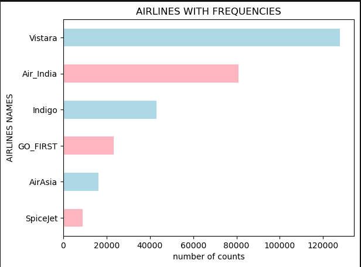
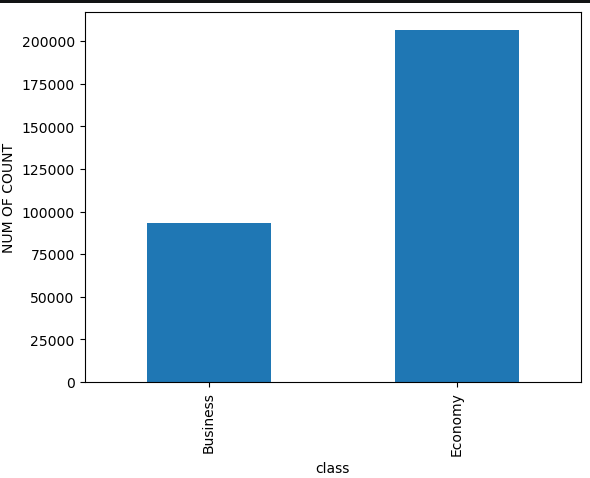
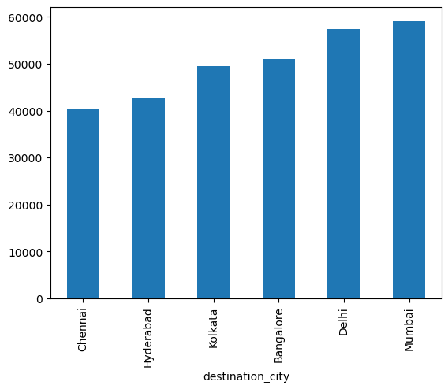

# ✈️ Airline Booking Data Analysis | Python & EDA

> An in-depth Exploratory Data Analysis (EDA) on **300,000+ flight bookings** across 6 major Indian airlines to uncover pricing dynamics, demand patterns, and route trends.


---

## 📌 Project Overview

This project analyzes a dataset of **300,153 flight bookings** across 6 Indian cities and 6 airlines. The goal was to go beyond raw numbers and answer critical business questions: *How does booking timing affect price? Which routes and airlines dominate the market? What is the pricing gap between Economy and Business class?*

Using **Python (Pandas, NumPy)**, I performed comprehensive data cleaning, exploratory data analysis, and data visualization to extract actionable business insights.

---

## 💡 Key Business Insights (The "So What?")

- **⏱️ The Last-Minute Premium**: Travelers who book flights within **3 days** of departure pay an average of **~174% more** compared to those who book **21+ days** in advance (₹13,800 vs ₹5,000).
- **💼 Class Disparity**: **Business class** tickets are on average **~8 times more expensive** than Economy class tickets.
- **🏢 Airline Dominance**: The market is heavily concentrated. **Vistara (127K bookings)** and **Air India (80K bookings)** account for the vast majority of the dataset, while SpiceJet represents the smallest share.
- **🗺️ Busiest Routes**: **Mumbai** and **Delhi** are the most frequented destination cities, indicating the highest volume of air traffic.
- **✈️ Extreme Flights**: The longest flight in the dataset is a **49.8-hour** journey (Chennai to Bangalore, Air India), while the most expensive ticket is a **₹1.23 Lakh** Business class flight (Kolkata to Delhi).

---

## 🖼️ Visualizations

**1. Airline Market Share**
*Vistara and Air India dominate the dataset, accounting for over 200,000 bookings combined.*


**2. Flight Class Distribution**
*The dataset is heavily skewed toward Economy class, which has over double the bookings of Business class.*


**3. Top Destination Cities**
*Mumbai and Delhi are the most frequented destinations, followed closely by Bangalore.*


---

## 🛠️ Tech Stack & Methodology

| **Category** | **Tools & Techniques** |
| :--- | :--- |
| **Language** | Python |
| **Data Manipulation** | Pandas, NumPy |
| **Data Visualization** | Matplotlib, Seaborn |
| **Techniques** | Data Cleaning, Handling Missing Values, EDA, GroupBy Aggregations, Feature Analysis |

**Methodology:**
1. **Data Profiling**: Loaded 300K+ rows and dropped redundant index columns. Verified zero null values and zero duplicates.
2. **Data Validation**: Checked unique values for airlines, classes, and cities to understand the categorical scope.
3. **Exploratory Analysis**: Used `.groupby()` and `.value_counts()` to segment data by airline, class, route, and booking timing.
4. **Visualization**: Created bar charts, line plots, and distribution plots to visually communicate trends.

---

## 📂 Repository Structure

```plaintext
AIRLINE_REPORT/
│
├── README.md
├── airlineproject.ipynb        ← Jupyter Notebook (Full code & analysis)
├── airlines.csv                ← Raw dataset
└── plot1.png, plot2.png, etc.  ← Exported visualizations
